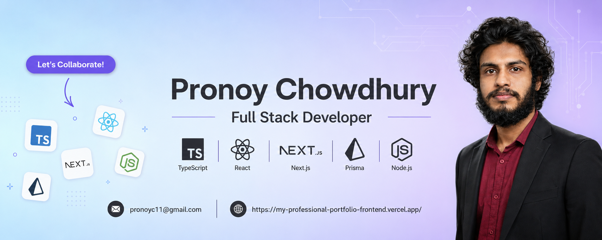

# 👋 Hi, I'm Pronoy Chowdhury

### Full Stack Developer

Building scalable web applications with **Next.js**, **Typescript**, **Prisma** & **PostgreSQL**

 

---

## 💫 About Me

- 👋 Hi, I'm **Pronoy Chowdhury**

- 🚀 Full Stack Developer from **Bangladesh** passionate about building scalable and modern web applications.

- 💻 Frontend: **React.js, Next.js, TypeScript, Tailwind CSS, Shadcn UI**

- ⚙️ Backend: **Node.js, Express.js, PostgreSQL, Prisma, JWT, Stripe**

- 🌱 Currently exploring **Docker, AWS, CI/CD and System Design**

- 🛠️ Currently building **Gear Up**, **DevPulse** and **Portfolio v1**

- 💬 Ask me about **React, Next.js, Node.js, Express.js, Prisma and PostgreSQL**

- 🌐 Portfolio: **[pronoychowdhury.vercel.app](https://my-professional-portfolio-frontend.vercel.app/)**

- 📄 Resume: **[View My Resume](https://drive.google.com/drive/u/0/folders/1o5akFPsvXXCW57QL_thEbYgMRKcJAF4q)**

- 📧 Email: **pronoyc11@gmail.com**
- ⚡ Fun Fact: **Clean Code • Coffee • Music • Continuous Learning ☕**

# 🛠️ Tech Stack

### 👨‍💻 Programming Languages

### 🎨 Frontend Development

### ⚙️ Backend Development

### 🗄️ Database

### ☁️ Tools & Platforms

---

# 💼 Experience

Looking for oppurtunaty

### 📌 Responsibilities

- 🚀 Developed responsive and modern web applications using **React** & **Next.js**
- 🎨 Built reusable UI components with **Tailwind CSS**
- 🔗 Integrated REST APIs with frontend applications
- 🤝 Collaborated with backend developers using Git & GitHub
- ⚡ Focused on performance optimization and clean code practices

---

# 🌱 Currently Exploring

- 🐳 Docker
- ☁️ AWS
- 🏗️ System Design
- 🔄 CI/CD
- ⚡ Advanced Backend Architecture

---

# 🎯 2026 Goals

- ✅ Become a Professional Full Stack Developer
- ✅ Master NestJS & Prisma
- ✅ Learn Docker & AWS
- ✅ Contribute to Open Source
- ✅ Build High Quality SaaS Applications

---

# 🚀 Featured Projects

# 📊 GitHub Insights

 

## 📊 GitHub Stats

|                                                 GitHub Stats                                                 |                                                 Most Used Languages                                                 |
| :----------------------------------------------------------------------------------------------------------: | :-----------------------------------------------------------------------------------------------------------------: |
|  |  |

---

---

## 🌐 Connect With Me

---

### 💙 Thanks for visiting my profile!

 

